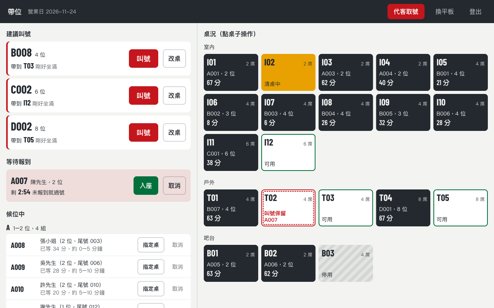
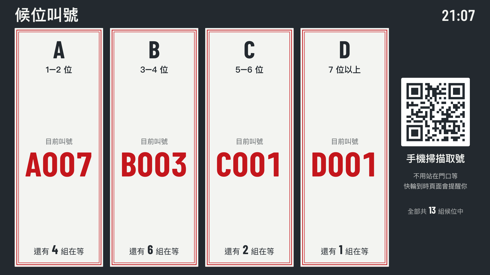
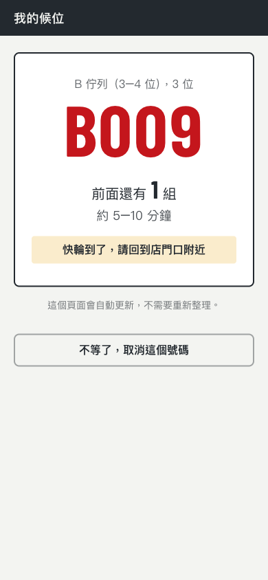
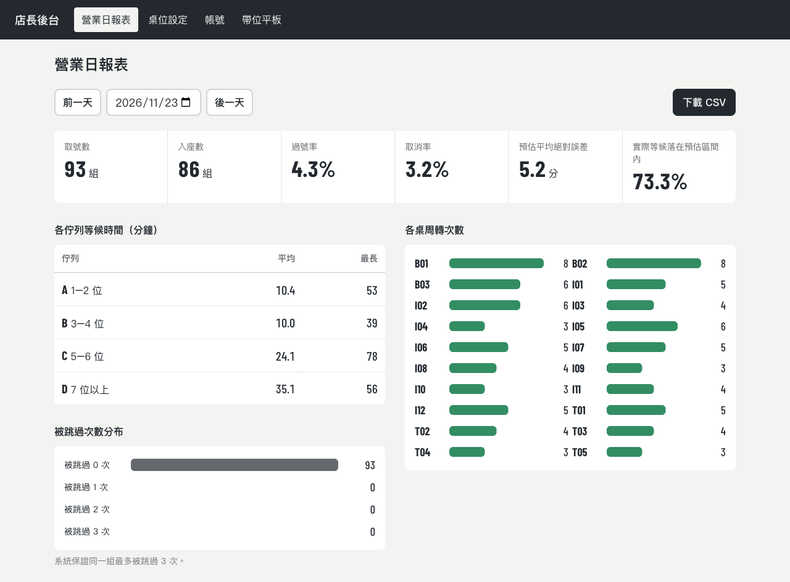
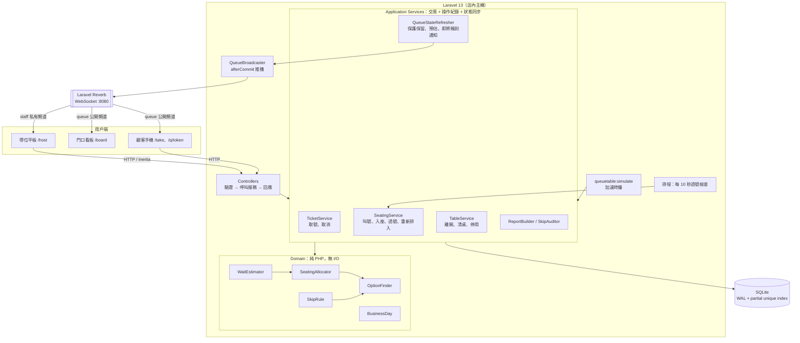

# QueueTable：熱炒店候位叫號與帶位系統

一間約 80 席的熱炒店，晚餐尖峰常有 30 組以上客人在門外等。過去用紙本寫號碼、店員喊號，常為跳號、插隊起爭執。QueueTable 把候位變成一條**公平、可稽核**的佇列：

- 客人用門口平板或手機掃 QR Code 取號，手機頁面即時顯示前面還有幾組、預估還要等多久。
- 帶位人員的平板直接建議「叫哪一組、帶到哪一桌」：浪費座位最少、必要時併相鄰桌，同一組客人最多被跳過 3 次。
- 門口看板與所有顧客頁面透過 WebSocket 即時更新，所有狀態變更都記錄時間、操作人員與平板。
- 附尖峰模擬器，用加速時鐘跑完一整晚，量測預估誤差並驗證跳號上限。

題目原文見 [`docs/requirements.md`](docs/requirements.md)，設計文件見 [`docs/superpowers/specs/2026-11-24-queuetable-design.md`](docs/superpowers/specs/2026-11-24-queuetable-design.md)。

| 帶位平板                                   | 門口看板                                   |
| ------------------------------------------ | ------------------------------------------ |
|      |     |
| **顧客頁面**                               | **營業日報表**                             |
|  |  |

---

## 目錄

1. [技術與需求環境](#1-技術與需求環境)
2. [安裝與啟動](#2-安裝與啟動)
3. [營業日與號碼規則](#3-營業日與號碼規則)
4. [帶位建議與跳號上限演算法](#4-帶位建議與跳號上限演算法)
5. [等候時間預估](#5-等候時間預估)
6. [尖峰模擬器與量測結果](#6-尖峰模擬器與量測結果)
7. [即時更新與延遲量測](#7-即時更新與延遲量測)
8. [系統架構](#8-系統架構)
9. [測試與驗收對照](#9-測試與驗收對照)
10. [已知限制](#10-已知限制)

---

## 1. 技術與需求環境

| 項目    | 版本 / 說明                                                      |
| ------- | ---------------------------------------------------------------- |
| PHP     | 8.3 以上（CI 同時驗證 8.3 與 8.4），需要 `pdo_sqlite`            |
| Node.js | 22 以上                                                          |
| 後端    | Laravel 13、Laravel Fortify（登入）、Laravel Reverb（WebSocket） |
| 前端    | Vue 3 + TypeScript + Inertia v3、Tailwind CSS 4，以 Vite 建置    |
| 資料庫  | SQLite（WAL 模式、`IMMEDIATE` 交易）                             |
| 測試    | Pest 4、PHPStan level 7、Pint、vite-plus lint                    |

不需要 Docker。

## 2. 安裝與啟動

```bash
composer install
npm install
cp .env.example .env
php artisan key:generate
touch database/database.sqlite
php artisan migrate --seed     # 20 張桌、帳號、兩台平板、近 30 天歷史用餐紀錄
npm run build
composer run dev               # 同時啟動網站、Reverb、排程（過號檢查）、Vite
```

`composer run dev` 會同時啟動四個程序：

| 程序     | 指令                        | 用途                             |
| -------- | --------------------------- | -------------------------------- |
| server   | `php artisan serve`         | 網站，預設 http://127.0.0.1:8000 |
| reverb   | `php artisan reverb:start`  | WebSocket，預設 port 8080        |
| schedule | `php artisan schedule:work` | 每 10 秒檢查叫號是否超過 3 分鐘  |
| vite     | `npm run dev`               | 前端開發伺服器                   |

推播使用 `ShouldBroadcastNow` 在交易提交後直接送出，**不需要 queue worker**。

### 頁面與展示帳號

| 頁面     | 網址                                              | 說明                                                |
| -------- | ------------------------------------------------- | --------------------------------------------------- |
| 入口     | `/`                                               | 連到下列頁面                                        |
| 門口看板 | `/board`                                          | 16:9 螢幕，各佇列叫到的號碼、等候組數、取號 QR Code |
| 手機取號 | `/take`                                           | 顧客輸入人數、稱呼、手機                            |
| 顧客狀態 | `/q/{token}`                                      | 取號後拿到的連結，可自行取消                        |
| 帶位平板 | `/host`                                           | 登入後先選擇是「平板 A」或「平板 B」                |
| 店長後台 | `/admin/reports`、`/admin/tables`、`/admin/users` | 營業日報表與 CSV、桌位與相鄰設定、建立帳號          |

| 帳號                                             | 密碼       | 角色     |
| ------------------------------------------------ | ---------- | -------- |
| `manager@queuetable.test`                        | `password` | 店長     |
| `host1@queuetable.test`、`host2@queuetable.test` | `password` | 帶位人員 |

> 這些帳號只供展示。帶位人員帳號由店長在後台建立，系統不開放自行註冊。

### 讓平板與手機連到主機

店內只有一台主機執行系統。要讓同一個區網內的平板與手機連線：

```bash
php artisan serve --host=0.0.0.0 --port=8000
php artisan reverb:start --host=0.0.0.0
```

並把 `.env` 的 `APP_URL` 改成主機的區網 IP（例如 `http://192.168.1.10:8000`），看板上的 QR Code 就會指向這個網址。`.env` 的 `REVERB_HOST` 維持 `localhost` 即可：前端偵測到 `localhost` 時，會改用目前網址的主機名稱連線 WebSocket。

## 3. 營業日與號碼規則

**營業日**：店家營業時間 17:00 到隔天 02:00，會跨過午夜，所以以台灣時間 **06:00** 切日。

```
營業日 = (台灣時間 − 6 小時) 的日期
2026-11-24 17:00 → 營業日 11/24
2026-11-25 01:59 → 營業日 11/24（凌晨取的號不會在午夜歸零）
2026-11-25 06:00 → 營業日 11/25
```

**號碼**：

- 依人數分四個佇列：A（1–2 位）、B（3–4 位）、C（5–6 位）、D（7 位以上，上限 12 位）。
- 格式為佇列字母加三位數，例如 `B012`；每個營業日、每個佇列從 001 開始。
- 發號在**同一個交易**內完成：遞增計數器 → 建立號碼 → 重算預估。任何一步失敗就整筆 rollback，號碼不會被吃掉，所以**不跳號**。取消、過號不會釋放號碼。
- 資料庫有唯一索引 `(business_date, ticket_code)`，保證號碼不重複。

**同一支手機只能有一筆等候中的號碼**：

- 手機號碼先正規化：`0912-345-678`、`+886 912 345 678` 都視為 `0912345678`。
- 應用層先檢查，拒絕時告訴客人原因與既有號碼（「此手機今天已有等候中的號碼 B001」）。
- 資料庫另有 partial unique index `(business_date, phone) WHERE status IN ('waiting','called')`，即使兩台裝置同時送出也只會成功一筆。

## 4. 帶位建議與跳號上限演算法

### 適合的桌子

一個「選項」是一張桌子，或**兩張相鄰**桌子的併桌（相鄰關係由店長在後台設定）。

- 適合 = 坐得下，而且浪費座位不超過 2 席（`config/queuetable.php` 的 `max_waste`）。
- 排序：**單桌一律優先於併桌** → 浪費少 → 桌號小。
- 只有在沒有任何空著的單桌選項時，才建議併桌。

### 建議誰、帶到哪

全域順序是取號時間（同一秒以先寫入者為先），跨四個佇列比較。

```
1. 先處理「保護中」的組（已被跳過 3 次）：
   有全空的適合選項 → 優先建議他
   沒有 → 把所有對他有用的空桌保留給他（別人拿不到）
2. 其餘組依全域順序，替每組找最佳的空桌選項；找到就建議
   排在前面但沒有適合桌子的組，會讓後面人數較少的組先入座
```

### 什麼算「被跳過」

我們採用**資源版**的定義：只有後面的人拿走了「P 用得到的桌子」，才算 P 被跳過一次。「用得到」是指那張桌子本身適合 P，或是它屬於某個適合 P 的併桌組合。

> 例：10 人組 P 只能坐 I10+I11 併桌，但 I11 還有人用餐。I10 空出時，如果後面的 4 人組被帶到 I10，P 被跳過一次。如果空出的是 P 怎麼樣都用不到的 2 人桌，給後面的人不算跳過 P。

另一種「嚴格版」的定義是「只要後面的人先入座就算跳過」，滿 3 次後所有人都得等 P 入座。這樣做會讓小桌閒置、翻桌率大幅下降，所以沒有採用。代價列在[已知限制](#10-已知限制)。

### 第 4 次之前保留桌子

1. 被跳過滿 3 次的組進入**保護**，所有對他有用的空桌一空出就被保留給他（平板顯示「保護保留」）。
2. 跳號計數**不會停在 3**：保護中的組照樣計算。正常情況下保護機制讓它不可能變成 4，所以：
3. 叫號時在交易內重新計算：如果這次叫號會讓任何人被跳過第 4 次，就**拒絕**，包括帶位人員手動指定桌子的情況。
4. 模擬器另外用 `SkipAuditor` 只讀操作紀錄**獨立重算**被跳過的次數，再和系統紀錄交叉比對，不只相信系統自己記的數字。

### 叫號、報到、過號

- 叫號後桌子進入「叫號保留」3 分鐘。帶位人員按「入座」就建立入座紀錄。
- 超過 3 分鐘未報到 → 過號、釋放桌子。排程每 10 秒檢查一次，平板、看板、顧客頁讀取前也會先檢查，所以就算排程沒在跑，狀態也是正確的。
- 過號的客人可以由帶位人員重新排入**同佇列第 3 位**（前面剩 2 組），每組只能一次。同佇列等候組數不足 2 組時，排到最後。

### 不會同時帶兩組到同一張桌子

- 叫號、入座都用條件式更新（`WHERE status = 'available' AND (held_for_party_id IS NULL OR = 自己)`）。影響筆數不符就 rollback，回傳「桌子剛被其他平板使用」。
- 資料庫層：`seating_tables` 有 partial unique index `(table_id) WHERE released_at IS NULL`，`seatings.party_id` 唯一。同一張桌子不會同時有兩組，同一組也不會有兩筆入座。

## 5. 等候時間預估

做法是**用帶位演算法本身把目前狀態快轉**：

1. **歷史用餐時間**：取近 14 個營業日、同佇列、同時段（17–18、19–20、21–22 點、其他）的用餐時間，計算 P25、P50、P75（nearest-rank，方便手算）。樣本少於 5 筆時，依序退回「同佇列全部時段」→「設定檔預設值」。
2. **每張桌子何時空出**：
    - 用餐中：入座時間 + 該組的用餐時間 + 清桌 5 分鐘。
    - 清桌中：開始清桌時間 + 5 分鐘。
    - 已叫號：現在 + 用餐時間 + 5 分鐘。
3. **前推模擬**：在虛擬時間上依序讓桌子空出，每次空出就呼叫同一個 `SeatingAllocator` 決定誰入座（包含併桌、跳號計數、保護保留），得到每組的預計入座時間。
4. **兩個情境**：樂觀情境用 P25、悲觀情境用 P75 各跑一次。區間 = `[floor5(兩者較小), ceil5(兩者較大)]`，顯示成「約 15–25 分鐘」。
5. 有客人入座、離開、取消、過號時都會重算所有人的預估並推播。
6. 取號當下的預估會存起來。入座後，實際等候與區間中點的差就是誤差，報表與模擬器以此計算**平均絕對誤差（MAE）**與**區間命中率**。

這樣做的好處是預估和實際帶位用的是同一套規則：規則改了預估自動跟著變，不會出現「說 10 分鐘，但規則讓別人先進去」的情況。

手算驗證見 `tests/Unit/Domain/WaitEstimatorTest.php`：兩張桌、三組客人，期望值 `[15,35]`、`[25,45]`、`[60,100]` 逐步寫在測試註解裡。

## 6. 尖峰模擬器與量測結果

```bash
php artisan queuetable:simulate --seed=42 --date=2026-11-24
php artisan queuetable:simulate --seed=42 --json=storage/app/sim.json   # 另存 JSON
```

- 使用獨立的 `database/simulation.sqlite`：每次重建資料表、建立桌位與模擬日之前 30 天的歷史，不影響開發資料。
- **加速時鐘**：虛擬時間每步 30 秒，以 `Carbon::setTestNow()` 推進，從 17:00 跑到所有客人處理完（最晚 03:00）。完整一晚在一般筆電約 30 秒。
- 每一步呼叫**真正的服務層**：新客取號 → 叫號的客人報到 → 用餐結束離開 → 清桌完成 → 過號檢查與重新排入 → 等不下去的客人取消 → 帶位人員依建議叫號。
- 參數在 `config/simulation.php`：
    - 到達率依時段不同，Poisson 到達，19 點最多每小時 30 組；01:30 後不再取號。
    - 人數分布：2 人 30%、4 人 25%……9–12 人合計 3%。
    - 用餐時間：與歷史資料相同的 lognormal 模型。
    - 8% 叫號後不報到，其中一半回來要求重新排入。
    - 每組耐心 30–90 分鐘，等超過就取消；另有 3% 隨機中途取消。
    - 清桌 3–7 分鐘。
- 相同 seed 結果完全相同（有測試）。

### 量測結果（營業日 2026-11-24，17:00–02:00）

主要結果（seed 42）：

| 項目                          | 結果                                  |
| ----------------------------- | ------------------------------------- |
| 取號 / 入座 / 過號 / 取消     | 120 / 106 / 7 / 9 組                  |
| **預估平均絕對誤差（MAE）**   | **5.4 分鐘**                          |
| 實際等候落在預估區間內        | 78.3%                                 |
| 平均等候                      | 19.1 分鐘                             |
| **最長等候**                  | **78 分鐘**（A 60、B 57、C 78、D 41） |
| 最多被跳過次數（稽核 / 系統） | 3 / 3，**PASS**                       |
| 桌位使用率（17:00–02:00）     | 67.0%                                 |
| 結束時仍在等候                | 0 組                                  |

不同 seed 的波動：

| seed | 取號 | 入座 | 取消 | MAE（分） | 區間命中率 | 平均等候（分） | 最長等候（分） | 最多被跳過 | 使用率 |
| ---- | ---- | ---- | ---- | --------- | ---------- | -------------- | -------------- | ---------- | ------ |
| 42   | 120  | 106  | 9    | 5.4       | 78.3%      | 19.1           | 78             | 3（PASS）  | 67.0%  |
| 1    | 135  | 102  | 26   | 9.7       | 73.5%      | 22.9           | 85             | 3（PASS）  | 61.0%  |
| 2    | 130  | 115  | 12   | 3.9       | 92.2%      | 11.9           | 55             | 3（PASS）  | 71.0%  |
| 3    | 134  | 105  | 25   | 8.3       | 70.5%      | 19.7           | 76             | 3（PASS）  | 68.7%  |
| 4    | 111  | 99   | 7    | 3.7       | 86.9%      | 8.7            | 48             | 3（PASS）  | 58.1%  |

五次模擬的 MAE 平均 6.2 分鐘、最長等候 48–85 分鐘。每一次都有客人被跳過滿 3 次並進入保護，但沒有任何人被跳過第 4 次，而且稽核重算的次數與系統紀錄一致。到客量越大（seed 1、3），取消的人越多，預估誤差也越大：取消會讓後面的人比預估更早入座。

指標說明：

- **預估平均絕對誤差**：取號當下預估區間中點與實際等候的差，所有入座組的平均。
- **區間命中率**：實際等候落在取號當下預估區間內的比例。
- **最多被跳過次數**：「稽核」是 `SkipAuditor` 從叫號紀錄獨立重算的結果，「系統」是資料庫中的 `skip_count`。兩者一致且不超過 3 才算 PASS。
- **桌位使用率**：17:00–02:00 間，用餐中的「桌 × 分鐘」÷ 可用的「桌 × 分鐘」。

## 7. 即時更新與延遲量測

- **公開頻道 `queue`**：看板與所有顧客頁訂閱。payload 只有號碼、狀態、前面組數與預估，**不含姓名、手機、token**（有測試）。
- **私有頻道 `staff`**：只通知帶位平板「有變動」，平板再以已登入的 HTTP 重新取得含姓名的資料。
- 推播在交易提交後送出；交易 rollback 時不送；同一個交易內的多次變動合併成一次推播。Reverb 沒啟動時只記 warning，不讓取號、入座失敗。

延遲量測腳本走和真實使用者相同的路徑（HTTP 表單含 CSRF → Laravel → Reverb → 訂閱者）：

```bash
composer run dev   # 另一個終端機
node scripts/measure-latency.mjs http://127.0.0.1:8000 10
```

本機實測（取號與取消各 10 次，共 20 次）：

```
量測 20 次（取號與取消各 10 次）
中位數 28 ms，P95 32 ms，最長 34 ms
結果：全部在 2 秒內
```

## 8. 系統架構



**分層原則**：

- **Domain**（`app/Domain`）是純函式，輸入快照、輸出結果，不碰資料庫與時鐘以外的東西。帶位建議、跳號計數、等候預估都在這裡，所以測試、預估前推、模擬器共用同一份邏輯。
- **Application Services**（`app/Services`）負責交易、條件式更新、操作紀錄，並在最後呼叫 `QueueStateRefresher` 同步所有衍生狀態。所有狀態變更都只能走這一層。
- **Controllers** 只做驗證與回應。業務規則違反時，網頁回到上一頁並顯示中文原因，JSON 回 422。

**時間**：全系統只從 `now()` 取得時間。測試用 `travelTo()`，模擬器用 `Carbon::setTestNow()` 推進虛擬時間；沒有任何測試等待真實時間。

### 主要資料表

| 表                           | 用途                                                               | 關鍵約束                                                                      |
| ---------------------------- | ------------------------------------------------------------------ | ----------------------------------------------------------------------------- |
| `parties`                    | 候位組                                                             | `unique(business_date, ticket_code)`、partial unique `(business_date, phone)` |
| `ticket_counters`            | 每營業日每佇列的號碼計數                                           | `unique(business_date, queue)`                                                |
| `dining_tables`              | 桌子，含 `held_for_party_id` + `hold_reason`（叫號保留／保護保留） | `unique(code)`                                                                |
| `table_adjacencies`          | 可併桌的相鄰桌                                                     | `unique(table_a_id, table_b_id)`                                              |
| `seatings`、`seating_tables` | 入座紀錄與使用的桌子                                               | `unique(party_id)`、partial unique `(table_id) WHERE released_at IS NULL`     |
| `notification_logs`          | 「即將輪到」通知紀錄                                               | `unique(party_id, type)`                                                      |
| `activity_logs`              | 操作紀錄：時間、操作者類型、使用者、平板、前後狀態                 |                                                                               |
| `devices`                    | 帶位平板                                                           |                                                                               |

### 桌位配置（seeder）

20 張桌、80 席。搭配「浪費不超過 2 席」，1 到 12 人都至少有一種坐法（有測試）。

| 區域 | 桌號    | 座位 | 相鄰（可併桌）                     |
| ---- | ------- | ---- | ---------------------------------- |
| 室內 | I01–I04 | 2    | I01–I02、I03–I04                   |
| 室內 | I05–I10 | 4    | I05–I06、I07–I08、I09–I10、I10–I11 |
| 室內 | I11–I12 | 6    | I11–I12                            |
| 戶外 | T01–T03 | 4    | T01–T02、T02–T03                   |
| 戶外 | T04–T05 | 8    | T04–T05                            |
| 吧台 | B01–B02 | 2    | B01–B02                            |
| 吧台 | B03     | 4    |                                    |

歷史資料為今天以前 30 個營業日，每晚約 90–125 組（固定亂數種子），用和模擬器相同的用餐時間模型產生。

## 9. 測試與驗收對照

```bash
composer test        # Pint + PHPStan level 7 + Pest
composer ci:check    # 再加上前端格式、lint 與 TypeScript 型別檢查（CI 執行這個）
```

目前共 214 個測試案例（165 個測試函式，部分以 dataset 展開），全部通過。GitHub Actions 在 PHP 8.3 與 8.4 上執行 `composer ci:check`。

| 驗收                                                           | 證據                                                                                                              |
| -------------------------------------------------------------- | ----------------------------------------------------------------------------------------------------------------- |
| 1. 安裝後可開啟三個頁面；20 張桌與 30 天歷史                   | `tests/Feature/Http/AccessControlTest.php`、`tests/Feature/Database/SeederTest.php`；本 README 第 2 節            |
| 2. 號碼格式、不重複、不跳號                                    | `tests/Feature/Services/TicketServiceTest.php`、`tests/Feature/Database/ConstraintsTest.php`                      |
| 3. 同手機重複取號被拒並顯示原因                                | `TicketServiceTest`（含不同格式的同一支手機）、`tests/Feature/Http/CustomerFlowTest.php`                          |
| 4. 浪費最少、只有併桌坐得下才併桌、只併相鄰桌                  | `tests/Unit/Domain/OptionFinderTest.php`、`SeatingServiceTest`                                                    |
| 5. 第 4 次跳過之前保留桌子                                     | `tests/Unit/Domain/SeatingAllocatorTest.php`、`SkipRuleTest.php`、`tests/Feature/Services/SkipProtectionTest.php` |
| 6. 3 分鐘過號、重新排入第 3 位、第二次過號不能再排入           | `tests/Feature/Services/NoShowTest.php`（以 `travelTo` 控制時鐘）                                                 |
| 7. 2 秒內更新看板與顧客頁                                      | `tests/Feature/Broadcasting/QueueBroadcastTest.php`；第 7 節延遲量測（最長 34 ms）                                |
| 8. 前面剩 2 組時剛好一則通知                                   | `tests/Feature/Services/QueueStateRefresherTest.php`                                                              |
| 9. 同桌不帶兩組、同組不帶兩桌                                  | `SeatingServiceTest`、`ConstraintsTest`                                                                           |
| 10. 預估與手算一致                                             | `tests/Unit/Domain/WaitEstimatorTest.php`、`DiningStatsTest.php`                                                  |
| 11. 模擬一晚，MAE 與最長等候寫在 README，沒有人被跳過超過 3 次 | 第 6 節；`tests/Feature/Simulation/SimulateCommandTest.php`、`SkipAuditorTest.php`                                |
| 12. 報表與手算一致；CSV 用 Excel 開啟不亂碼                    | `tests/Feature/Reports/ReportBuilderTest.php`、`ReportCsvTest.php`（UTF-8 BOM）                                   |
| 13. 所有狀態變更都有時間、操作人員、平板                       | `ActivityLoggerTest`、`TableServiceTest`、`SeatingServiceTest`、`HostActionsTest`                                 |
| 14. 測試至少 45 個且全數通過                                   | `composer test`                                                                                                   |

## 10. 已知限制

- **跳號採資源版定義**：P 用不到的桌子給晚來的人，不算跳過 P。站在門口的客人仍可能覺得「他比我晚來卻先進去」，需要帶位人員說明（例如「那是兩人桌」）。
- **稽核以目前桌位設定判斷**：`SkipAuditor` 用現在的桌位與相鄰設定判斷「相關桌」。營業中若修改桌位，稽核結果可能和當時不同。
- **預估是確定性前推**：以歷史分位數計算，不模擬突發的大量取消或過號；客人很少的時段樣本不足時，會退回較粗的統計。
- **過號最晚 3 分 10 秒**：Laravel 排程最細只支援固定秒級間隔，這裡用每 10 秒；有人開啟平板或顧客頁時會立即檢查。
- **推播依賴 Reverb**：Reverb 未啟動時操作照常完成並記 warning，但畫面要重新整理才會更新。帶位平板另外每 30 秒自動同步一次。
- **單機 SQLite**：兩台平板的併發依賴 SQLite 的寫入鎖與條件式更新，沒有做高併發壓測。資料量以每晚 150 組、保存一年為設計上限。
- **只處理兩張相鄰桌併桌**：不處理三張以上的併桌、入座後換桌、事先訂位。
- **不真的發送通知**：「即將輪到」只寫入通知紀錄表，顧客要開著頁面才看得到。
- **展示用設定**：`.env.example` 內的 Reverb 金鑰與展示帳號密碼只適合區網展示，正式使用前要更換，並以 HTTPS 提供服務。
