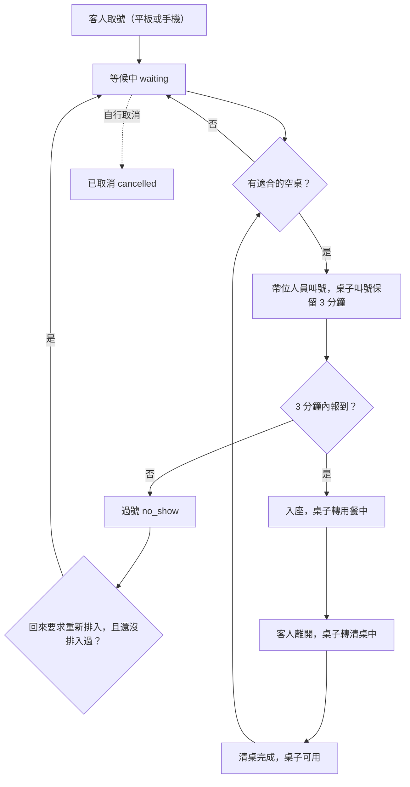
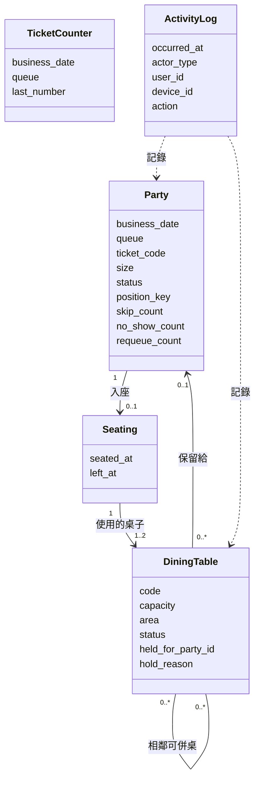
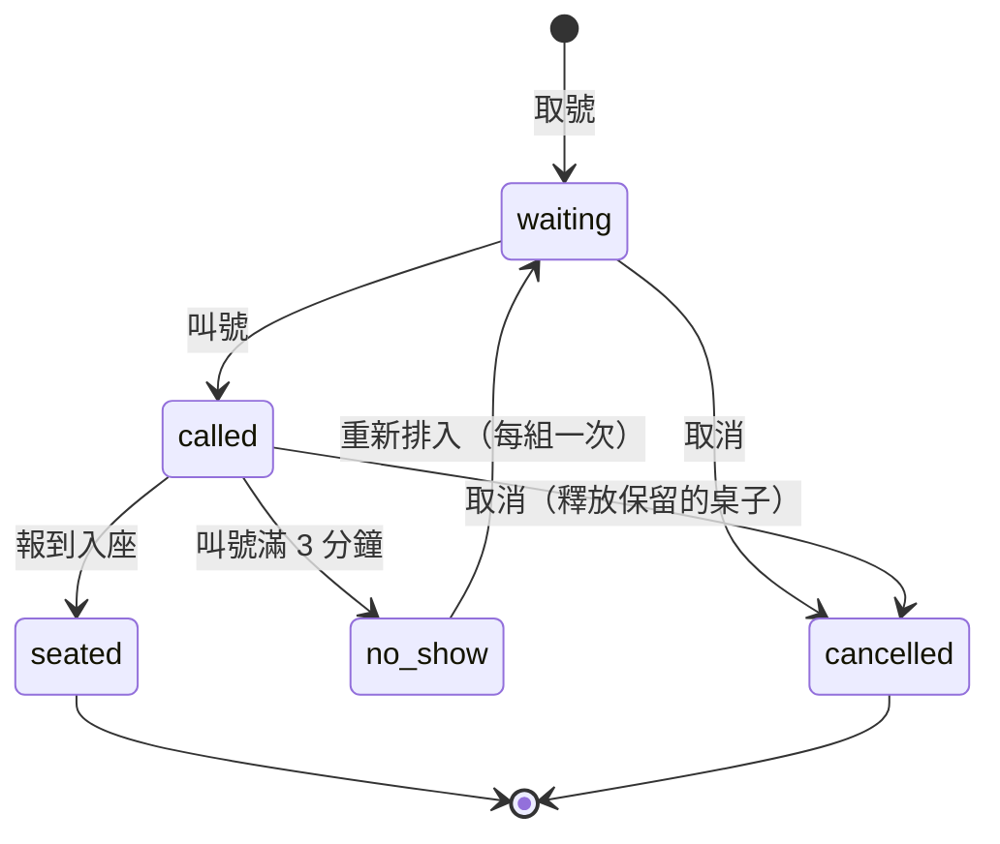
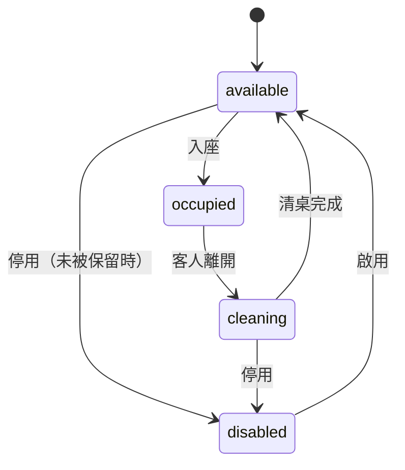

# 02 系統分析

這一章把需求拆成系統行為：一組客人從取號到離開經過哪些狀態、有哪些核心實體、每條需求落在哪個檔案。

## 主要業務流程

一組客人在系統裡的一生：從取號到入座、用餐、離開，桌子再回到可用。

每一個方框都是一次狀態變更，都會走同一條路：在交易內改資料、寫操作紀錄、重算所有人的預估、交易提交後推播。見 [03 章](03-architecture.md)。

## 核心使用情境

### 情境一：顧客用手機遠端取號

- **前置條件**：客人在店門口掃了看板上的 QR Code，打開 `/take`。
- **主要步驟**：
  1. 輸入人數、稱呼、手機號碼後送出。
  2. 系統把手機號碼正規化，確認今天沒有同一支手機的有效號碼。
  3. 在同一個交易內遞增號碼計數器、建立號碼、算出預估等候區間。
  4. 導到 `/q/{token}`，頁面顯示號碼、前面幾組、預估等候，之後透過 WebSocket 自動更新。
- **例外情況**：
  - 同一支手機今天已有等候中的號碼 → 拒絕，訊息附上既有號碼（「此手機今天已有等候中的號碼 B001」）。
  - 人數超過 12 → 拒絕，請洽現場店員。
  - 手機格式錯誤 → 拒絕並說明正確格式。

### 情境二：帶位人員依建議叫號、入座

- **前置條件**：帶位人員已登入並選好「平板 A」或「平板 B」；有桌子剛清好。
- **主要步驟**：
  1. 平板的「建議叫號」卡片顯示「叫 B012 → I05（剛好坐滿）」。
  2. 按「叫號」：系統檢查這次叫號會不會讓任何人被跳過第 4 次，然後把桌子保留給 B012。
  3. 客人到門口，按「入座」：建立入座紀錄，桌子轉為用餐中。
  4. 門口看板、所有顧客頁、另一台平板在 2 秒內更新。
- **例外情況**：
  - 兩台平板同時按同一張桌子 → 後到的那台收到「桌子剛被其他平板使用」。
  - 連按兩次入座 → 第二次收到中文錯誤訊息，不會出現錯誤頁。
  - 3 分鐘內沒報到 → 排程或下一次讀取時轉為過號，桌子釋放。

### 情境三：大組客人被小桌客人越過

- **前置條件**：10 人組 P 排在最前面，但能坐 10 人的 I10–I11–I12 都有人。
- **主要步驟**：
  1. 2 人桌空出，系統建議後面的 2 人組先入座，P 被記一次「被跳過」。
  2. 發生第 3 次後，P 進入保護：I10、I11、I12 任何一張空出都保留給 P，平板顯示「保護保留」。
  3. 2 人桌對 P 沒用，照常給後面的人，不再計數。
  4. 相鄰的兩張桌子都空出時，系統優先建議 P。
- **例外情況**：帶位人員手動把後面的人帶到 P 用得到的桌子 → 系統拒絕，訊息說明「B003 已被跳過 3 次，這張桌子必須保留給他」。

## 領域模型

只列理解系統需要的關鍵屬性。資料表的完整欄位見 [05 章](05-database.md)。

幾個值得注意的建模決定：

- **保留不是第五種桌子狀態**。題目規定桌子只有四種狀態，所以「叫號保留」與「保護保留」用 `held_for_party_id` + `hold_reason` 兩個附加欄位表示，狀態仍是「可用」。📄 設計文件 §5.6。
- **併桌最多兩張**，所以 `Seating` 對 `DiningTable` 是 1 對 1..2。📄 題目「假設事項」。
- **`position_key` 和號碼分開**。號碼是給人看的；`position_key` 決定排隊順序，重新排入時可以插到兩組之間。

## 狀態轉換

### 候位組（Party）

`waiting` 與 `called` 合稱「有效號碼」：同一支手機只能有一筆，見 `app/Domain/Enums/PartyStatus.php` 的 `isActive()`。

### 桌子（DiningTable）

用餐中與被保留的桌子不能停用，避免把已叫號的客人帶到停用的桌子。見 `app/Services/TableService.php` 的 `disable()`。

## 需求追溯表

從需求直接跳到實作所在的檔案。

| 需求 | 主要實作 | 主要測試 |
|---|---|---|
| FR-01、FR-02 桌位與狀態 | `app/Models/DiningTable.php`、`app/Http/Controllers/Admin/TableController.php` | `tests/Feature/Http/AdminTest.php` |
| FR-03、FR-04、FR-05 取號與號碼 | `app/Services/TicketService.php`、`app/Domain/QueueLetter.php`、`app/Domain/BusinessDay.php` | `tests/Feature/Services/TicketServiceTest.php` |
| FR-06 同手機一筆 | `app/Support/PhoneNumber.php`、`TicketService` + partial unique index | `TicketServiceTest`、`tests/Feature/Database/ConstraintsTest.php` |
| FR-07、FR-08 等候預估 | `app/Domain/Estimation/WaitEstimator.php`、`app/Services/QueueStateRefresher.php` | `tests/Unit/Domain/WaitEstimatorTest.php` |
| FR-09 帶位建議 | `app/Domain/Seating/OptionFinder.php`、`app/Domain/Seating/SeatingAllocator.php` | `tests/Unit/Domain/OptionFinderTest.php`、`SeatingAllocatorTest.php` |
| FR-10 跳號上限 | `app/Domain/Seating/SkipRule.php`、`app/Services/SeatingService.php` | `tests/Feature/Services/SkipProtectionTest.php` |
| FR-11 過號與重新排入 | `SeatingService::expireNoShows()`、`SeatingService::requeue()`、`routes/console.php` | `tests/Feature/Services/NoShowTest.php` |
| FR-12、FR-13、FR-14 看板、顧客頁、即時更新 | `app/Services/QueueSnapshotBuilder.php`、`app/Services/QueueBroadcaster.php`、`resources/js/pages/board/Index.vue`、`resources/js/pages/customer/Status.vue` | `tests/Feature/Broadcasting/QueueBroadcastTest.php`、`scripts/measure-latency.mjs` |
| FR-15 即將輪到通知 | `QueueStateRefresher` | `tests/Feature/Services/QueueStateRefresherTest.php` |
| FR-16 桌況操作 | `app/Services/TableService.php`、`resources/js/components/host/TableGrid.vue` | `tests/Feature/Services/TableServiceTest.php` |
| FR-17 操作紀錄 | `app/Services/ActivityLogger.php`、`app/Support/ActorContext.php` | `tests/Feature/Services/ActivityLoggerTest.php` |
| FR-18 營業日報表 | `app/Services/Reports/ReportBuilder.php`、`ReportCsvExporter.php` | `tests/Feature/Reports/ReportBuilderTest.php` |
| FR-19、FR-21 模擬器 | `app/Simulation/SimulationRunner.php`、`app/Console/Commands/SimulateCommand.php`、`app/Services/SkipAuditor.php` | `tests/Feature/Simulation/SimulateCommandTest.php` |
| FR-20 放寬浪費上限 | `OptionFinder::bestFreeOptionFor()`、`OptionFinder::isValidChoiceFor()` | `OptionFinderTest`、`tests/Feature/Services/SeatingServiceTest.php` |
