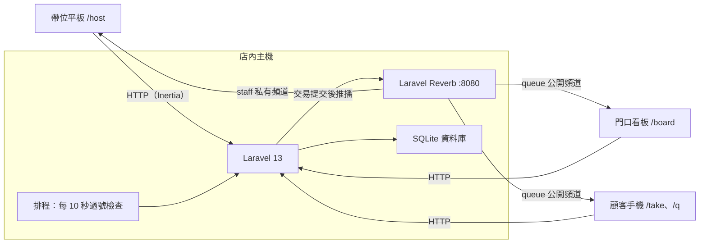
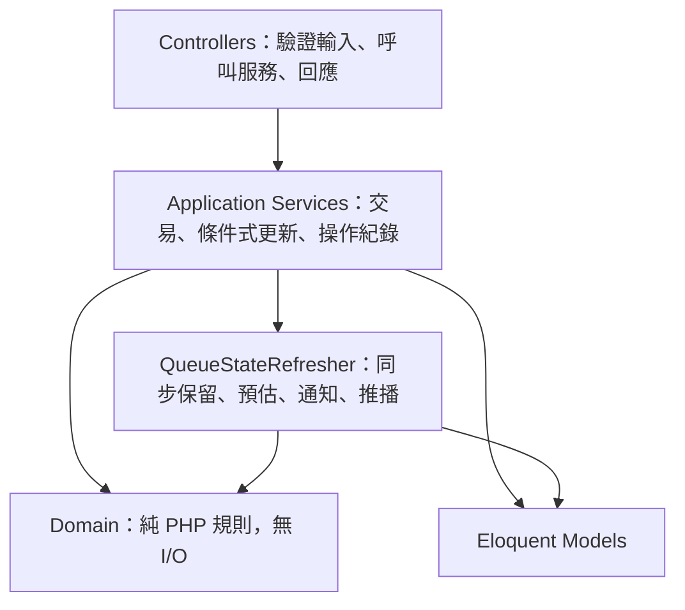
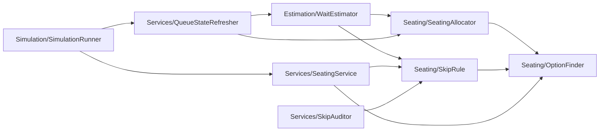

# 03 架構設計

這一章說明系統怎麼被切開。重點只有一句：**業務規則全部寫在不碰資料庫的 Domain 層，所以測試、等候預估、模擬器可以共用同一份規則。**

## 整體架構

店內只有一台主機，跑 Laravel 網站、Reverb（WebSocket）與排程；平板、手機、看板透過區網連線。



> 📄 依據：題目「店內只有一台主機執行系統，兩台平板與顧客手機透過網路連線」、「不需要 Docker」

## 分層與職責



| 層 | 位置 | 職責 | 不做什麼 |
|---|---|---|---|
| Domain | `app/Domain/` | 選桌、帶位建議、跳號規則、等候預估、營業日 | 不碰資料庫、不讀 request；只吃「快照」吐「結果」 |
| Application Services | `app/Services/` | 開交易、條件式更新、寫操作紀錄、最後呼叫 refresh | 不自己實作規則，規則交給 Domain |
| Controllers | `app/Http/Controllers/` | 驗證輸入、把 request 轉成 `ActorContext`、回應 | 不放業務邏輯 |
| 前端 | `resources/js/` | 顯示、送出操作、訂閱 WebSocket | 不做任何規則判斷 |

> 📄 依據：設計文件 §6、實作計畫的 Architecture 段落；開發第一輪討論時使用者同意此架構。

為什麼 Domain 要「純」？因為同一套規則有三個使用者：

1. **叫號服務**：真實的叫號、入座。
2. **等候預估**：在虛擬時間上把規則快轉一遍（[08 章](08-algorithms.md)）。
3. **模擬器**：用加速時鐘跑一整晚。

如果規則寫在 Service 或 Model 裡，預估器就得另外寫一份「大概的規則」，兩邊遲早不一致。

## 目錄結構

```
app/
├── Domain/                 純規則，不相依 Laravel 資料庫
│   ├── BusinessDay.php     營業日（06:00 切日）
│   ├── QueueLetter.php     人數 → A/B/C/D 佇列
│   ├── DiningTimeModel.php 用餐時間機率模型（seeder 與模擬器共用）
│   ├── Enums/              PartyStatus、TableStatus、HoldReason 等
│   ├── Seating/            選桌、帶位建議、跳號規則
│   └── Estimation/         歷史統計、前推模擬預估
├── Services/               交易 + 紀錄 + 同步 + 推播
│   └── Reports/            營業日報表與 CSV
├── Simulation/             尖峰模擬器（呼叫真正的 Services）
├── Http/
│   ├── Controllers/        Board、Customer、Host、Admin
│   └── Middleware/         選平板、店長權限、過號檢查
├── Events/                 QueueUpdated（公開）、FloorUpdated（私有）
├── Support/                ActorContext、PhoneNumber
├── Exceptions/             業務規則違反（中文訊息）
└── Models/                 Eloquent models
resources/js/
├── pages/                  board、customer、host、device、admin
├── components/             host（桌況格、改桌對話框）、shop、admin
└── composables/            WebSocket 訂閱、平板操作
```

## 模組相依

Domain 只相依自己與 PHP 標準函式庫，沒有循環相依。



`OptionFinder` 是最底層的規則：「這組人能坐哪些桌子」。帶位建議、跳號判斷、叫號檢查、預估全部透過它，所以「浪費上限放寬」這種規則只要改這一個類別（commit `9ace858`）。

## 用到的設計模式

| 模式 | 在哪裡 | 為什麼用 | 不用會怎樣 |
|---|---|---|---|
| 快照（Snapshot）＋純函式 | `FloorSnapshot`、`TableSnapshot`、`WaitingParty` 傳給 `SeatingAllocator::allocate()` | 規則可以在任何「狀態」上執行，包括預估器虛構的未來狀態 | 規則得直接查資料庫，預估器無法在虛擬時間上重用 |
| 服務層（Service Layer） | `TicketService`、`SeatingService`、`TableService` | 所有狀態變更只能從這裡進來，交易、紀錄、推播不會漏 | 每個 Controller 各自處理交易與紀錄，容易漏掉某一步 |
| 單一同步點 | `QueueStateRefresher::refresh()` | 衍生狀態（保留、預估、通知、推播）只有一個地方負責 | 某個操作忘了重算預估，畫面就和事實不一致 |
| 值物件（Value Object） | `TableOption`、`Estimate`、`DurationStats`、`ActorContext` | 不可變（`final readonly class`），傳來傳去不怕被改 | — |
| 例外轉譯 | `QueueTableException` 與子類別，在 `bootstrap/app.php` 統一轉成表單錯誤或 422 | 業務規則違反時，使用者看到中文原因而不是錯誤頁 | 每個 Controller 自己 try/catch |

> 🔍 推斷：沒有使用 Repository Pattern 包 Eloquent；`FloorRepository` 只負責「從資料庫讀出 Domain 需要的快照」，寫入仍直接用 Eloquent。對這個規模的專案，多一層寫入抽象的效益不大。

## 橫切關注點

| 關注點 | 做法 | 位置 |
|---|---|---|
| 交易 | 每個 Service 方法包一個 `DB::transaction`；SQLite 設定 `transaction_mode = IMMEDIATE`，寫入交易一開始就取得寫入鎖 | `config/database.php`、`app/Services/*` |
| 併發 | 條件式更新（`WHERE status = 'available' AND ...`）＋ partial unique index | `SeatingService::call()`、migration |
| 操作紀錄 | 所有狀態變更在同一交易內呼叫 `ActivityLogger::record()` | `app/Services/ActivityLogger.php` |
| 誰做的 | `ActorContext`：員工（含平板）、顧客、系統 | `app/Support/ActorContext.php` |
| 驗證授權 | Fortify 登入；`device` 中介軟體要求先選平板；`manager` 中介軟體限店長 | `bootstrap/app.php`、`app/Http/Middleware/` |
| 錯誤處理 | 業務規則違反丟 `QueueTableException`，統一轉成中文訊息；推播失敗記 warning 不中斷業務 | `bootstrap/app.php`、`app/Services/QueueBroadcaster.php` |
| 時間 | 全系統只用 `now()`；測試用 `travelTo()`，模擬器用 `Carbon::setTestNow()` | 見 [11 章](11-tradeoffs-pitfalls.md) |
| 設定 | 業務常數集中在 `config/queuetable.php`，模擬參數在 `config/simulation.php` | — |
| 過號 | 排程每 10 秒檢查，讀取頁面前也先檢查一次 | `routes/console.php`、`app/Http/Middleware/ExpireNoShows.php` |
