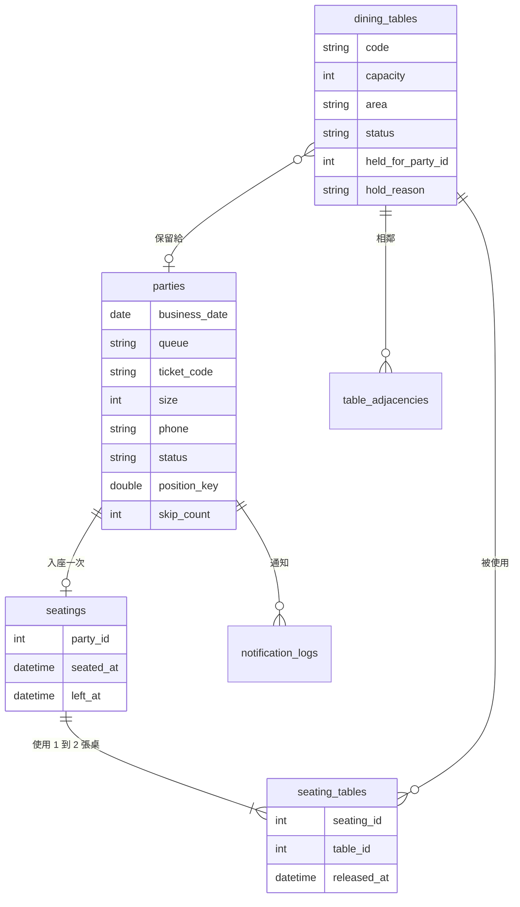

# 05 資料庫設計

這個專案的資料庫設計最值得學的是：**把「不能發生的事」交給資料庫的唯一索引擋**，而不只靠應用程式檢查。兩台平板同時按下按鈕時，應用層的檢查可能都通過，但資料庫只會讓一筆寫進去。

所有資料表定義在 `database/migrations/2026_11_24_000002_create_queue_tables.php`；`users.role` 欄位在 `database/migrations/2026_11_24_000001_add_role_to_users_table.php`。

## ER 圖

核心的候位與入座資料：



其他資料表：

| 資料表 | 用途 |
|---|---|
| `ticket_counters` | 每營業日、每佇列的號碼計數器 |
| `activity_logs` | 操作紀錄：時間、操作者類型、使用者、平板、動作、前後狀態、meta（JSON） |
| `devices` | 帶位平板（「平板 A」「平板 B」） |
| `users` | 帳號，`role` 為 `manager` 或 `host` |
| `table_adjacencies` | 可併桌的相鄰桌，存成 `table_a_id < table_b_id` |

## 核心資料表

### `parties`：候位組

| 欄位 | 型別 | 可空 | 說明 |
|---|---|---|---|
| `business_date` | date | 否 | 營業日（06:00 切日），不是取號的日曆日期 |
| `queue` | char(1) | 否 | A／B／C／D |
| `number`、`ticket_code` | int、string | 否 | 號碼數字與顯示用的 `B012` |
| `size`、`name`、`phone` | — | 否 | 人數、稱呼、正規化後的手機（`09` 開頭 10 碼） |
| `channel` | string | 否 | `kiosk`（門口平板）或 `remote`（手機） |
| `token` | uuid | 否 | 顧客狀態頁 `/q/{token}` 的連結，唯一 |
| `status` | string | 否 | `waiting`、`called`、`seated`、`no_show`、`cancelled` |
| `position_key` | double | 否 | 排隊順序。取號時為毫秒時間戳記，同一營業日嚴格遞增 |
| `skip_count`、`no_show_count`、`requeue_count` | int | 否 | 被跳過、過號、重新排入的次數 |
| `issued_at`、`called_at`、`seated_at`、`cancelled_at` | datetime | 部分可空 | 各狀態的時間點 |
| `est_low_at_issue`、`est_high_at_issue` | int | 是 | **取號當下**的預估區間，用來算預估誤差 |
| `est_low`、`est_high` | int | 是 | **目前**的預估區間，每次狀態變更都會重算 |

索引：

- `unique(business_date, ticket_code)`：同營業日號碼不重複（驗收 2）。
- `parties_active_phone_unique`：`(business_date, phone) WHERE status IN ('waiting','called')`，同手機只能有一筆有效號碼（驗收 3）。
- `index(business_date, status)`：幾乎每個查詢都用這兩個條件。

為什麼預估要存兩組？`est_*` 會一直被覆寫成最新值；如果只存這一組，客人入座時就不知道「取號時說要等多久」，算不出預估誤差。

### `dining_tables`：桌子

| 欄位 | 說明 |
|---|---|
| `code` | 桌號，例如 `I05`、`T01`，唯一 |
| `capacity`、`area` | 座位數、區域（`indoor`、`outdoor`、`bar`） |
| `status` | `available`、`occupied`、`cleaning`、`disabled` |
| `held_for_party_id`、`hold_reason` | 保留給哪一組、原因（`called` 叫號保留／`protected` 保護保留） |
| `status_changed_at` | 預估「清桌中的桌子什麼時候可用」時要用 |

### `seatings` 與 `seating_tables`：入座紀錄

- `seatings.party_id` 唯一：同一組只會有一筆入座（驗收 9 的後半）。
- `seating_tables_active_unique`：`(table_id) WHERE released_at IS NULL`，同一張桌子同時只會屬於一筆進行中的入座（驗收 9 的前半）。

客人離開時，`seatings.left_at` 和 `seating_tables.released_at` 都填上時間，這張桌子就能再被下一筆入座使用。

## Partial unique index：資料庫層的併發保證

Laravel 的 Schema Builder 沒有 partial index 的語法，所以用原生 SQL 建立：

```php
// database/migrations/2026_11_24_000002_create_queue_tables.php
// 同一支手機在同一營業日只能有一筆有效（等候中、已叫號）的號碼，由資料庫保證
DB::statement("CREATE UNIQUE INDEX parties_active_phone_unique ON parties (business_date, phone) WHERE status IN ('waiting', 'called')");

// ...

// 同一張桌子同時只能屬於一筆進行中的入座，由資料庫保證
DB::statement('CREATE UNIQUE INDEX seating_tables_active_unique ON seating_tables (table_id) WHERE released_at IS NULL');
```

一般的 `unique(business_date, phone)` 做不到這件事：客人取消後就該能再取號，但取消的那筆資料還在表裡。Partial index 只對「有效」的那幾筆生效，正好符合規則。

應用層仍然會先檢查一次，目的是給出好懂的錯誤訊息（「此手機今天已有等候中的號碼 B001」）。資料庫索引是最後一道防線：兩台裝置同時送出時，應用層檢查都會通過，由索引擋下其中一筆。`TicketService::issue()` 會把 `UniqueConstraintViolationException` 轉成同樣的中文訊息。

## 正規化與刻意的反正規化

- `parties.queue` 可以從 `size` 推算，但仍然存下來：幾乎每個查詢都要依佇列分組，存起來省去每次換算。
- `parties.ticket_code` 可以由 `queue + number` 組出來，存下來是為了唯一索引與查詢方便。
- `seatings.business_date` 可以由 `party` 查到，存一份是為了報表直接依營業日撈入座紀錄。

> 🔍 推斷：以上反正規化都是「讀取方便、寫入只有一處」的欄位，沒有不一致的風險，所以這樣做的代價很小。

## SQLite 設定

```php
// config/database.php（sqlite 連線）
'busy_timeout' => 5000,
'journal_mode' => 'wal',
'transaction_mode' => 'IMMEDIATE',
```

- **WAL 模式**：讀取不會被寫入擋住，看板與顧客頁大量讀取時不卡。
- **`IMMEDIATE`**：寫入交易一開始就拿寫入鎖。預設的 `DEFERRED` 要等到第一個寫入才升級鎖，兩個交易都先讀後寫時，可能同時讀到「桌子空著」。用 `IMMEDIATE` 後，所有寫入交易排隊執行。
- **`busy_timeout`**：拿不到鎖時最多等 5 秒，而不是直接回錯誤。

模擬器另外用一個 `simulation` 連線，資料庫檔是 `database/simulation.sqlite`，每次執行都重建，不影響開發資料。

## 查詢重點

| 查詢 | 位置 | 注意事項 |
|---|---|---|
| 等候清單（依 `position_key, id` 排序） | `FloorRepository::waiting()` | 每次狀態變更都會執行；靠 `(business_date, status)` 索引 |
| 近 14 天的用餐時間 | `FloorRepository::diningStats()` | 每次狀態變更都會重算，約 1,500 筆。歷史資料不含當天，整個營業日內不會變，可以快取（列在延後處理清單） |
| 號碼計數 | `TicketService::nextNumber()` | `insertOrIgnore` 建立計數器，再 `increment`；在 `IMMEDIATE` 交易內，不會兩個人拿到同一號 |
| 排序鍵 | `TicketService::nextPositionKey()` | 讀同營業日的 `max(position_key)`，保證嚴格遞增 |

## Migration 歷程

只有兩個 migration，開發期間沒有修改過 schema。之後的規則變更（例如嚴格跳號計數需要知道「叫號當下哪些桌子空著」）都存在 `activity_logs.meta` 這個 JSON 欄位，沒有動到資料表結構。

> 📄 依據：`git log -- database/migrations` 只有 commit `3700235` 與 `1d44e5e`。
