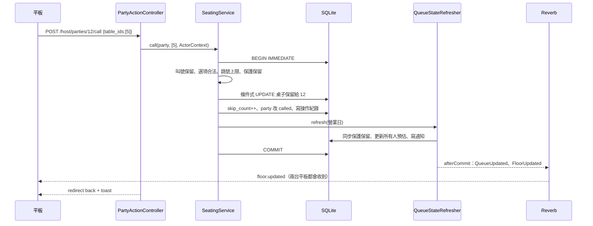
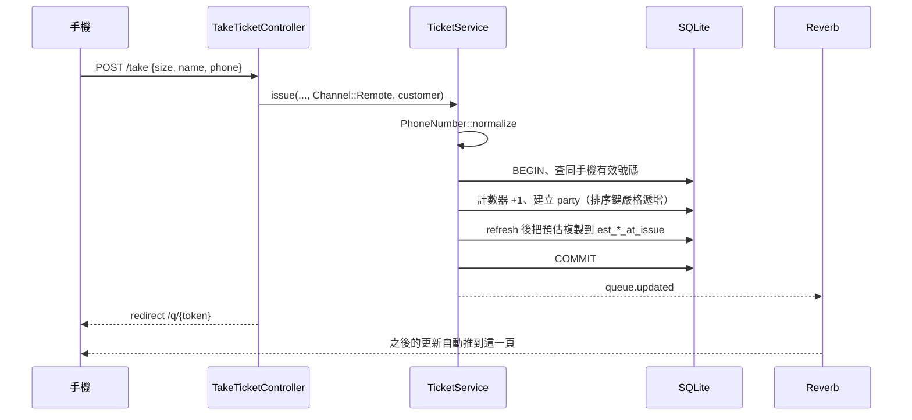

# 06 API 規格與資料流

這個系統沒有給第三方用的 REST API。對外介面是 Inertia 頁面（HTTP）加上兩個 WebSocket 頻道；只有「改選其他桌」用一個 JSON 端點。路由定義在 `routes/web.php`、`routes/channels.php`、`routes/console.php`。

## 端點

### 公開（不需登入）

讀取類端點都掛了 `expire` 中介軟體：顯示前先檢查叫號是否已超過 3 分鐘。

| Method | 路徑 | 用途 | 處理位置 |
|---|---|---|---|
| GET | `/` | 入口頁 | `resources/js/pages/Welcome.vue` |
| GET | `/board` | 門口看板 | `Board\BoardController@show` |
| GET | `/take` | 手機取號表單 | `Customer\TakeTicketController@create` |
| POST | `/take` | 取號（每 IP 每分鐘 20 次） | `Customer\TakeTicketController@store` |
| GET | `/q/{token}` | 顧客狀態頁 | `Customer\PartyStatusController@show` |
| POST | `/q/{token}/cancel` | 顧客自行取消 | `Customer\PartyStatusController@cancel` |

### 帶位平板（登入 + 已選平板）

| Method | 路徑 | 用途 | 處理位置 |
|---|---|---|---|
| GET／POST | `/device` | 選擇平板（只需登入） | `DeviceController` |
| GET | `/host` | 帶位平板主畫面 | `Host\HostController@show` |
| POST | `/host/parties` | 代客取號（`channel = kiosk`） | `Host\PartyActionController@store` |
| GET | `/host/parties/{party}/options` | 這組目前可叫號的合法選項（JSON） | `Host\PartyActionController@options` |
| POST | `/host/parties/{party}/call` | 叫號，body 帶 `table_ids[]` | `Host\PartyActionController@call` |
| POST | `/host/parties/{party}/check-in` | 報到入座 | `Host\PartyActionController@checkIn` |
| POST | `/host/parties/{party}/cancel` | 取消 | `Host\PartyActionController@cancel` |
| POST | `/host/parties/{party}/requeue` | 過號後重新排入 | `Host\PartyActionController@requeue` |
| POST | `/host/tables/{table}/{leave,clean,disable,enable}` | 桌況操作 | `Host\TableActionController` |

### 店長（登入 + `manager`）

| Method | 路徑 | 用途 | 處理位置 |
|---|---|---|---|
| GET | `/admin/reports?date=Y-m-d` | 營業日報表 | `Admin\ReportController@show` |
| GET | `/admin/reports/{date}/csv` | 下載 CSV | `Admin\ReportController@csv` |
| GET／POST／PUT | `/admin/tables`、`/admin/tables/{table}`、`/admin/tables/{table}/adjacency` | 桌位與相鄰設定 | `Admin\TableController` |
| GET／POST | `/admin/users` | 建立帶位人員帳號 | `Admin\UserController` |

Controller 都在 `app/Http/Controllers/` 下。

## 回應與錯誤格式

### Inertia 頁面

一般操作（叫號、入座……）成功後 redirect 回上一頁，並用 `Inertia::flash('toast', ...)` 帶一則成功訊息；平板前端只重新載入 `state` 這個 prop（`resources/js/composables/useHostAction.ts`）。

### 業務規則違反

所有業務規則違反都丟 `App\Exceptions\QueueTableException` 的子類別，在 `bootstrap/app.php` 統一轉換：

```php
// bootstrap/app.php
$exceptions->render(function (QueueTableException $e, Request $request) {
    if ($request->expectsJson()) {
        return response()->json(['message' => $e->getMessage()], 422);
    }

    $field = match (true) {
        $e instanceof DuplicateActivePhone, $e instanceof InvalidPhoneNumber => 'phone',
        $e instanceof PartySizeOutOfRange => 'size',
        default => 'action',
    };

    return back()->withErrors([$field => $e->getMessage()])->withInput();
});
```

手機相關的錯誤掛在 `phone` 欄位，取號表單就能把訊息顯示在手機輸入框下面；其他錯誤掛在 `action`，平板用 toast 顯示。這樣 Controller 完全不用 try/catch。

JSON 錯誤範例（重複入座）：

```json
{ "message": "號碼 B012 目前為「已入座」，無法入座" }
```

### `/host/parties/{party}/options` 回應

```json
{
  "options": [
    { "table_ids": [5], "codes": ["I05"], "capacity": 4, "waste": 1, "combined": false }
  ]
}
```

只列出現在空著、坐得下、浪費不超標的選項；有空著的單桌時不會列出併桌。等候滿 15 分鐘後，會多列出浪費 3 席的選項。

## WebSocket 頻道

| 頻道 | 類型 | 事件 | 誰訂閱 | 內容 |
|---|---|---|---|---|
| `queue` | 公開 | `.queue.updated` | 看板、所有顧客頁 | 完整候位快照，**不含姓名、手機、token** |
| `staff` | 私有 | `.floor.updated` | 帶位平板 | 只有「有變動」的訊號，平板再用 HTTP 重新取得資料 |

`queue.updated` 的內容（`app/Services/QueueSnapshotBuilder.php`）：

```json
{
  "business_date": "2026-11-24",
  "generated_at": "2026-11-24T19:30:00+08:00",
  "queues": { "A": { "now_calling": "A007", "waiting_count": 4 }, "B": { "...": "..." } },
  "parties": [
    { "ticket_code": "B009", "queue": "B", "status": "waiting", "ahead": 1, "est_low": 5, "est_high": 10 }
  ]
}
```

為什麼兩個頻道的設計不同？公開頻道誰都能訂閱，所以只放號碼這類本來就公開在看板上的資訊；顧客頁從快照裡用自己的號碼找到自己那筆。平板需要姓名和手機末三碼，這些不能放公開頻道，所以私有頻道只送訊號，資料走已登入的 HTTP。

> 📄 依據：設計文件 §5.13。

## 核心流程的資料流

### 流程一：叫號

帶位人員按下建議卡的「叫號」，一路到另一台平板與看板更新。



### 流程二：顧客取號



### 流程三：叫號 3 分鐘未報到

過號沒有人按按鈕，由兩個地方觸發：

1. 排程每 10 秒執行 `SeatingService::expireNoShows()`（`routes/console.php`）。
2. 任何人打開看板、顧客頁或平板時，`ExpireNoShows` 中介軟體先執行一次。

所以就算排程沒在跑，畫面上的狀態也是對的。

## 驗證與授權

| 層級 | 做法 |
|---|---|
| 員工登入 | Fortify，只開放登入；登入後導到 `/host`（`config/fortify.php` 的 `home`） |
| 平板識別 | `EnsureDeviceSelected`：沒有有效的 `device_id` cookie 就導到 `/device`。cookie 是加密的長效 cookie |
| 店長功能 | `EnsureManager`：`User::isManager()` 為否就回 403 |
| 顧客 | 不需要帳號；`/q/{token}` 的 token 是 UUID，等同一把只有本人知道的鑰匙 |
| 私有頻道 | `routes/channels.php` 的 `staff` 頻道只允許已登入使用者。前端在 `resources/js/app.ts` 自訂 `authorizer`，從 `XSRF-TOKEN` cookie 帶 CSRF token |
| 操作者記錄 | `ActorContext::fromRequest()`：已登入 → 員工 + 平板；否則 → 顧客 |
