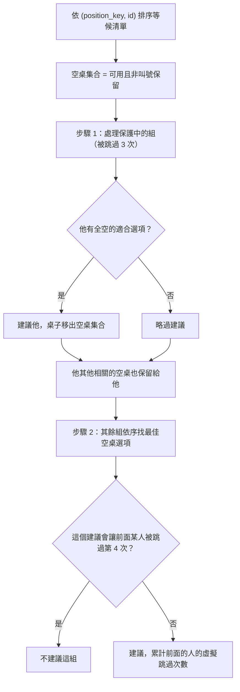
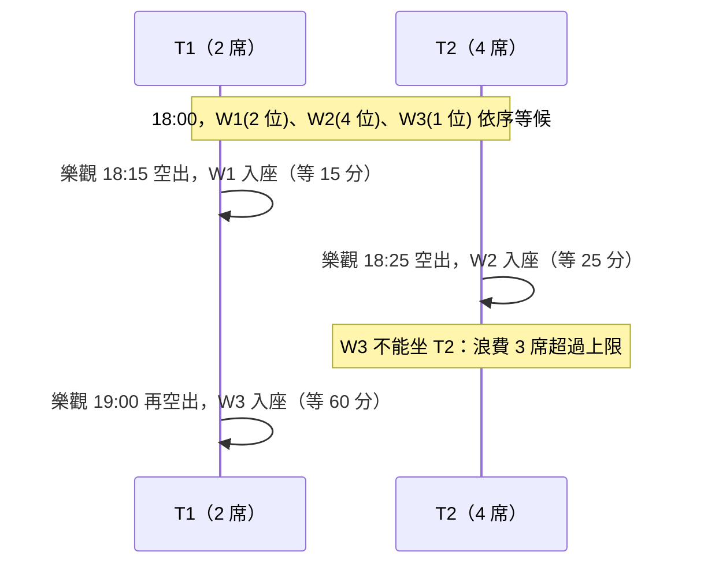

# 08 核心演算法

這個專案有四個值得拆解的演算法：選桌、帶位建議、跳號計數、等候預估。另外加上「怎麼用模擬驗證它們」。

## 1. 選桌：一組人能坐哪些桌子

**問題**：5 位客人，空著 I11（6 席）和 T04（8 席），還有相鄰的 I05、I06（各 4 席），該坐哪裡？

**輸入**：人數、桌況快照（含相鄰關係）、「空」的判斷函式、浪費上限。
**輸出**：最佳的 `TableOption`（一張或兩張桌），或 `null`。

**步驟**：

```text
allOptions(size, maxWaste):
  單桌：每張非停用桌，若 size ≤ 座位 ≤ size + maxWaste → 選項
  併桌：每一對相鄰桌，若兩者皆非停用且 size ≤ 座位合計 ≤ size + maxWaste → 選項
  排序：單桌一律在前 → 浪費少 → 桌號小

bestFreeOption(size, isFree, maxWaste):
  回傳 allOptions 中第一個「所有桌子都 isFree」的選項

bestFreeOptionFor(party, isFree, now):              # 加上等候放寬
  best(maxWaste = 2)
  ?? (已等滿 15 分鐘 ? best(maxWaste = 3) : null)
```

上面的例子：I11 浪費 1 席，是第一名。若 I11 有人：T04 浪費 3 席、I05+I06 浪費 3 席，一般上限 2 都不行；等滿 15 分鐘後放寬，單桌優先，選 T04。

**實作位置**：`app/Domain/Seating/OptionFinder.php`

**複雜度**：T 張桌、A 對相鄰關係，列舉 O(T + A)，排序 O(n log n)。20 張桌、11 對相鄰，可以忽略。

**邊界條件**：

- **單桌優先於浪費少**：4 人可以坐 2+2 併桌（浪費 0）或一張 6 人桌（浪費 2）。題目要求「只有併桌才坐得下時才建議併桌」，所以選 6 人桌。最初的排序是先比浪費，違反驗收 4，設計審查時抓到。📄 設計文件審查紀錄。
- **停用桌**：不構成任何選項，也不能當併桌的一半。
- **放寬的範圍**：只有「沒有任何一般上限內的空選項」時才看放寬後的選項，所以放寬永遠不會搶走一般選項的優先權。

**替代做法**：用「浪費率」（浪費 ÷ 座位）而不是浪費席數排序。🔍 推斷：題目寫「浪費座位最少」，用席數比較直接對應題意，也比較好手算。

## 2. 帶位建議：桌子空出時叫誰

**問題**：一張 2 人桌空出，最前面是 10 人組，後面有幾組 2 人客人，系統該建議誰？

**輸入**：桌況、等候清單（含被跳過次數、取號時間）、目前時間。
**輸出**：建議清單（哪一組 → 哪個選項），以及保護保留（哪張桌 → 保留給誰）。

**步驟**：



**實作位置**：`app/Domain/Seating/SeatingAllocator.php` 的 `allocate()`

**三個不明顯的細節**：

1. **保護組拿到建議後，他其他相關的空桌也保留**。否則帶位人員如果先按了後面那組的卡片，後面那組會拿走保護組的相關桌，叫號就被跳號上限拒絕。📄 最終審查發現的問題（commit `0d4c311`）。
2. **同一輪累計虛擬跳過次數**。同一輪可能有好幾張建議卡；Z 已被跳過 2 次，X1、X2 兩張建議都會跳過 Z 的話，依序按下去第二張會被拒絕。所以第二張根本不該出現。
3. **以參照捕捉空桌集合**，見 [07 章](07-code-walkthrough.md)。

**複雜度**：W 組等候、每組列舉 O(T + A) 個選項，一次分配 O(W × (T + A) + W² ) 左右（同輪跳過計算要掃前面的組）。40 組等候時是幾萬次運算，毫秒等級。

**替代做法**：

- **全域最佳化**（例如把所有組與桌子做匹配，最大化坐滿的座位數）：使用率可能更高，但結果難以向客人解釋「為什麼他先進去」。題目的核心痛點是公平爭執，所以選擇「依序、每組挑最好的」這種貪婪（greedy）做法。🔍 推斷。
- **讓前面的人等**：最前面的組沒桌就誰都不帶。最公平，但小桌閒置，題目也明說可以讓後面的人先進去。

## 3. 跳號計數：什麼算「被跳過」

這是整個專案改最多次的規則，三個版本都留在 git 歷史裡，很適合用來學「規則定義如何影響結果」。

**題目原文**：「輪到的客人沒有適合的桌子時，可以先讓後面的人入座，但同一組客人最多被跳過 3 次，之後系統保留下一張適合的桌子給他。」

**目前的規則**（`app/Domain/Seating/SkipRule.php` 的 `counts()`）：後面的組被叫號、分配到某些桌子時，排在前面還在等的 P：

```text
counts(P, 已被跳過次數, 這次分配的桌子, 空桌判斷):
  if P 扣掉這次分配的桌子後，當下仍有全空的適合選項
      return 不算            # P 自己也拿得到桌子，沒有被插隊
  if 已被跳過次數 < 3
      return 算一次           # 沒桌可坐、後面的人先進去
  return 這次分配的桌子 ∩ P 的相關桌 ≠ ∅
                             # 保護中：只有拿走他用得到的桌子才算（會被拒絕）
```

**演變過程**：

| 版本 | 定義 | 為什麼改 |
|---|---|---|
| v1 資源版 | 後面的人拿走「P 用得到的桌子」才算 | 開發前討論時使用者選擇。理由是嚴格版會讓小桌閒置。📄 對話紀錄、commit `455fb5b` |
| v2 | v1 再加上「P 自己也拿得到桌子就不算」 | 兩張建議卡被反過來按時，前面那組不該被算跳過。📄 使用者同意、commit `9a20261` |
| v3 嚴格版（目前） | 沒桌可坐、後面的人先入座就算；保護後只保留相關桌 | 外部審查實測：seed 42 有 10 人組被 16 組越過只記 2 次，從未進入保護。📄 commit `9ace858` |

v1 的盲點在於：它以為「嚴格計數」就必須「滿 3 次後所有人都等 P」，所以會讓小桌閒置。v3 把這兩件事拆開：**計數用嚴格定義，保留範圍只限相關桌**。10 人組被 3 組 2 人客人越過後進入保護，之後 2 人桌對他沒用，照常給別人，不再計數，所以計數永遠停在 3。

**誰在用這條規則**：

| 使用者 | 怎麼用 |
|---|---|
| `SeatingService::call()` | 真的叫號時，計算這次會跳過誰；有人會變成第 4 次就拒絕 |
| `SeatingAllocator` | 同一輪內模擬累計，避免給出會被拒絕的建議 |
| `WaitEstimator` | 前推時更新虛擬跳過次數，讓保護也反映在預估裡 |
| `SkipAuditor` | 從操作紀錄獨立重算，驗證系統沒有記錯 |

四個地方共用同一個 `counts()`，規則只寫一次。

**邊界條件**：

- **跳過次數為什麼保證不超過 3**：保護組的相關空桌都被保留，後面的人拿不到；叫號時還會再檢查一次，會變成第 4 次就拒絕，包括手動指定桌子。
- **過號後重新排入**：`skip_count` 保留，不歸零。
- **叫號後又取消**：已經加上去的跳過次數不回溯。🔍 推斷：回溯需要追蹤每次跳過的來源，增加複雜度，而叫號後取消的情況不多。

**取捨**：嚴格計數讓更多組進入保護，模擬中 5–6 人組的取消率從 31% 降到 17.5%，但預估平均誤差從 6.2 升到 8.7 分鐘。📄 README 第 6 節。

## 4. 等候預估：用帶位規則本身前推

**問題**：一組客人剛取號，前面還有 3 組、桌子都有人，他大概要等多久？

**輸入**：目前時間、桌況、用餐中的組（入座時間、佇列）、清桌中的桌（開始時間）、已叫號的組、等候清單、歷史用餐時間統計。
**輸出**：每組一個區間，例如 `[15, 25]` 分鐘；坐不下的組為 `null`（顯示「請洽現場店員」）。

**步驟**：

```text
estimate():
  for 情境 in [樂觀 P25, 悲觀 P75]:
      每張桌子的預計空出時間：
          用餐中 → 入座時間 + 該組用餐時間[情境] + 清桌 5 分
          清桌中 → 開始清桌 + 5 分
          叫號保留 → 現在 + 用餐時間[情境] + 5 分
      t = 現在
      while 還有人在等:
          用 SeatingAllocator 在虛擬時間 t 的桌況上分配
          每個被分配到的組：入座時間 = t；他的桌子在 t + 用餐時間 + 5 分 空出
          用 SkipRule 更新其他人的虛擬跳過次數
          t = 下一張桌子空出的時間；沒有就結束
  區間 = [floor5(兩情境較小值), ceil5(兩情境較大值)]，寬度為 0 時上限 +5
```

**實作位置**：`app/Domain/Estimation/WaitEstimator.php`；歷史統計在 `app/Domain/Estimation/DiningStatsBuilder.php`。

**手算例子**（`tests/Unit/Domain/WaitEstimatorTest.php`）：



悲觀情境同理得到 35、45、100 分，所以區間是 W1 `[15,35]`、W2 `[25,45]`、W3 `[60,100]`。

**為什麼取兩情境的最小與最大，而不是直接 [樂觀, 悲觀]**：貪婪分配下，用餐時間變長可能改變桌子空出的順序，某一組的悲觀結果反而比樂觀早。直接用 `[樂觀, 悲觀]` 會出現下限大於上限。📄 設計審查時 reviewer 指出。

**歷史統計的百分位**：用 nearest-rank：`rank = ceil(p/100 × n)`，取排序後第 rank 筆。樣本 `[30,40,50,60,70]` 的 P25 是第 2 筆 40。比線性內插好手算，驗收 10 要求「與手算結果一致」。

**樣本不足時的退回**：同佇列同時段樣本少於 5 筆 → 用同佇列全部時段；還是不夠 → 用設定檔預設值（A 50、B 65、C 80、D 95 分，P25/P75 = ±15 分）。

**複雜度**：每個事件呼叫一次分配，事件數約等於等候組數，O(W² × (T + A))。40 組等候約數十萬次運算，每次狀態變更都會重算，實測仍在毫秒到數十毫秒之間。

**邊界條件**：

- **同一輪的桌子要先標成已佔用**：同一輪有多個虛擬入座時，前面已分出去的桌子在後面判斷「是否被跳過」時要視為已佔用，否則會少算跳過次數。手算案例：修正前算出 `[10,30]`，修正後是正確的 `[35,55]`。📄 commit `9a20261`。
- **超時未離開的桌子**：預計空出時間取 `max(現在, 入座 + 用餐時間)`，不會算出過去的時間。
- **永遠坐不下**：沒有任何選項時 `while` 迴圈會因為沒有下一個事件而結束，該組回傳 `null`。

**替代做法**：公式法「前面組數 ÷ 適合桌數 × 平均用餐時間」。好手算，但跨佇列共用桌子、併桌、保護保留都反映不出來。📄 設計文件 §4.3。

## 5. 驗證：加速時鐘模擬與獨立稽核

**問題**：上面的規則在一整晚的尖峰下表現如何？保證真的成立嗎？

**做法**（`app/Simulation/SimulationRunner.php`）：

1. `ArrivalGenerator` 用固定 seed 產生一晚的客人：Poisson 到達（間隔服從指數分布），各時段到達率不同；人數、耐心、是否過號、報到延遲全部事先決定。
2. 虛擬時鐘每步前進 30 秒（`Carbon::setTestNow()`），依序：新客取號 → 報到 → 離開 → 清桌 → 過號檢查與重新排入 → 等不下去的客人取消 → 依建議叫號。
3. 每一步都呼叫**真正的 Service**，和平板按按鈕走同一條路。
4. 結束後用 `SkipAuditor` 從操作紀錄獨立重算跳過次數，和 `parties.skip_count` 比對。

**輸出的檢查**：

| 檢查 | 通過條件 |
|---|---|
| 跳號檢查 | 稽核與系統的最大跳過次數一致，且都不超過 3 |
| 建議一致性 | 系統建議被叫號服務拒絕 0 次 |

只要有一項 FAIL，指令就回傳非 0 的 exit code，CI 測試會抓到。

**值得學的地方**：模擬器抓到過兩個單元測試沒抓到的 bug（保護保留判斷不一致、舊的建議卡失效），也提供了規則取捨的量化依據（嚴格計數前後的取消率比較）。見 [11 章](11-tradeoffs-pitfalls.md)。
