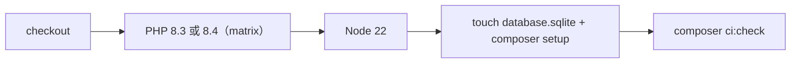

# 10 部署與環境設定

目標：在一台新機器上把系統跑起來，並讓店裡的平板與手機連得到。

## 環境需求

| 項目 | 需求 |
|---|---|
| PHP | 8.3 以上，需要 `pdo_sqlite` 擴充 |
| Composer | 2.x |
| Node.js | 22 以上 |
| 網路 | 建置前端時需要連網（下載字型），執行時不需要 |
| 其他 | 不需要 Docker、Redis、MySQL |

> 📄 依據：題目「不需要 Docker」；README 第 1、2 節。

## 本機啟動

```bash
composer install
npm install
cp .env.example .env
php artisan key:generate
touch database/database.sqlite
php artisan migrate --seed     # 20 張桌、帳號、兩台平板、近 30 天歷史用餐紀錄
npm run build
composer run dev               # 網站、Reverb、排程、Vite
```

`composer run dev` 實際執行的是 Laravel 13 的 `php artisan dev`，要啟動哪些程序註冊在 `app/Providers/AppServiceProvider.php` 的 `configureDevCommands()`：

| 程序 | 指令 | 用途 |
|---|---|---|
| server | `php artisan serve` | 網站 http://127.0.0.1:8000 |
| reverb | `php artisan reverb:start` | WebSocket，port 8080 |
| schedule | `php artisan schedule:work` | 每 10 秒檢查過號 |
| vite | `npm run dev` | 前端開發伺服器 |
| logs | `php artisan pail` | 即時看 log（Starter Kit 預設） |

展示帳號（密碼皆為 `password`，只供展示）：`manager@queuetable.test`（店長）、`host1@queuetable.test`、`host2@queuetable.test`（帶位人員）。

### 讓平板與手機連到主機

```bash
php artisan serve --host=0.0.0.0 --port=8000
php artisan reverb:start --host=0.0.0.0
```

並把 `.env` 的 `APP_URL` 改成主機的區網 IP，看板上的 QR Code 才會指向正確的網址。`REVERB_HOST` 可以維持 `localhost`：`resources/js/app.ts` 偵測到 `localhost` 時，會改用瀏覽器目前網址的主機名稱連 WebSocket。

## 設定項

### `.env`

只列與本專案相關的項目，其餘為 Laravel 預設。範例值一律是佔位符。

| 名稱 | 用途 | 範例值 | 必填 |
|---|---|---|---|
| `APP_KEY` | 加密金鑰（cookie、session） | 由 `php artisan key:generate` 產生 | 是 |
| `APP_URL` | 網站網址，看板 QR Code 會用到 | `http://<主機區網 IP>:8000` | 是 |
| `DB_CONNECTION` | 資料庫 | `sqlite` | 是 |
| `BROADCAST_CONNECTION` | 推播驅動 | `reverb` | 是 |
| `REVERB_APP_ID`、`REVERB_APP_KEY`、`REVERB_APP_SECRET` | Reverb 應用程式識別 | `<your-app-id>`、`<your-key>`、`<your-secret>` | 是 |
| `REVERB_HOST`、`REVERB_PORT`、`REVERB_SCHEME` | 後端連 Reverb 的位址 | `localhost`、`8080`、`http` | 是 |
| `VITE_REVERB_*` | 前端連 Reverb 的位址（建置時寫入前端） | 引用上面的值 | 是 |
| `SIMULATION_DB_DATABASE` | 模擬器資料庫檔路徑 | 預設 `database/simulation.sqlite` | 否 |

> `.env.example` 內附了一組展示用的 Reverb 金鑰，只適合區網展示，正式使用前要更換。

### 業務常數：`config/queuetable.php`

| 鍵 | 預設 | 說明 |
|---|---|---|
| `business_day_cutoff_hour` | 6 | 幾點切換營業日 |
| `max_party_size` | 12 | 取號人數上限 |
| `max_waste` | 2 | 一般情況最多浪費幾席 |
| `relaxed_max_waste`、`relax_after_minutes` | 3、15 | 等候滿幾分鐘可放寬到幾席 |
| `max_skips` | 3 | 最多被跳過幾次 |
| `no_show_minutes` | 3 | 叫號後幾分鐘未報到算過號 |
| `requeue_limit` | 1 | 每組可重新排入幾次 |
| `cleaning_minutes` | 5 | 預估時的清桌時間 |
| `coming_soon_ahead` | 2 | 前面剩幾組時發「即將輪到」通知 |
| `estimate_history_days`、`estimate_min_samples` | 14、5 | 預估取樣天數、每組最少樣本數 |
| `default_dining_minutes`、`default_dining_spread` | A 50、B 65、C 80、D 95；15 | 沒有歷史資料時的預設用餐時間 |

模擬器參數（到達率、人數分布、耐心、過號率……）在 `config/simulation.php`。

### SQLite 連線（`config/database.php`）

`journal_mode = wal`、`transaction_mode = IMMEDIATE`、`busy_timeout = 5000`。原因見 [05 章](05-database.md)。

## 建置與 CI

GitHub Actions 設定在 `.github/workflows/tests.yml`，對 `main` 的 push 與所有 PR 執行：



`composer setup`（`composer.json` 的 scripts）會安裝相依、建立 `.env`、產生金鑰、執行 migration、建置前端。`composer ci:check` 依序跑前端格式與 lint、TypeScript 型別檢查、Pint、PHPStan、Pest。

在 PHP 8.3 與 8.4 都跑一次，是為了確保題目要求的「PHP 8.3 以上」真的成立（相依套件版本的取捨見 [04 章](04-tech-stack.md)）。

## 常見啟動錯誤

以下都是本次開發實際遇到的狀況。

| 症狀 | 原因 | 解法 |
|---|---|---|
| 頁面空白，console 顯示連不到 `[::1]:5173` | `public/hot` 檔殘留，Laravel 以為 Vite 開發伺服器還在跑 | 刪除 `public/hot`，或啟動 `npm run dev` |
| `php artisan reverb:install` 失敗：`Pusher::__construct(): Argument #1 ($auth_key) must be of type string, null given` | `.env` 已經是 `BROADCAST_CONNECTION=reverb`，但 Reverb 金鑰還沒產生 | 先把 `BROADCAST_CONNECTION` 暫時改成 `log`，執行 `reverb:install` 後再改回 |
| `migrate:fresh` 之後出現 `database is locked` | Reverb 程序還開著舊的資料庫連線 | 重建資料庫後重啟 `reverb:start` |
| `npm run build` 失敗，找不到字型 | 建置時要從 fonts.bunny.net 下載字型 | 在有網路的環境建置，再把整個專案複製到店內主機 |
| PHPStan 因記憶體不足中止 | 預設 128 MB 不夠 | `composer.json` 已設定 `phpstan analyse --memory-limit=1G` |
| 平板一直被導到選平板頁 | 沒有有效的 `device_id` cookie（換了瀏覽器、清了 cookie、裝置被刪除） | 重新選一次平板 |
